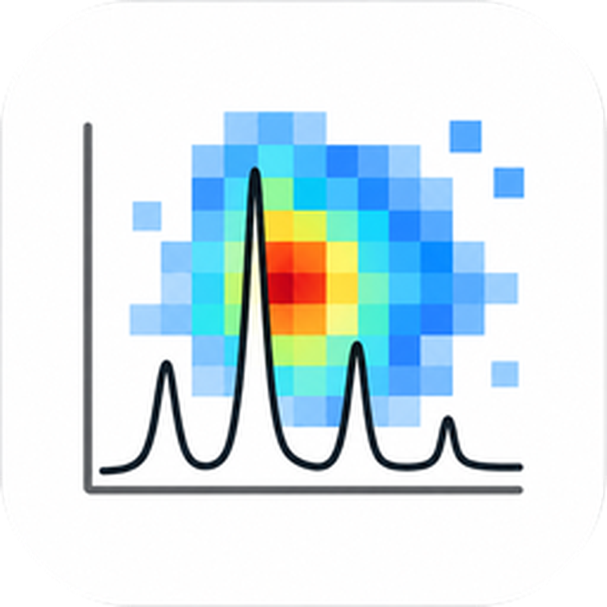
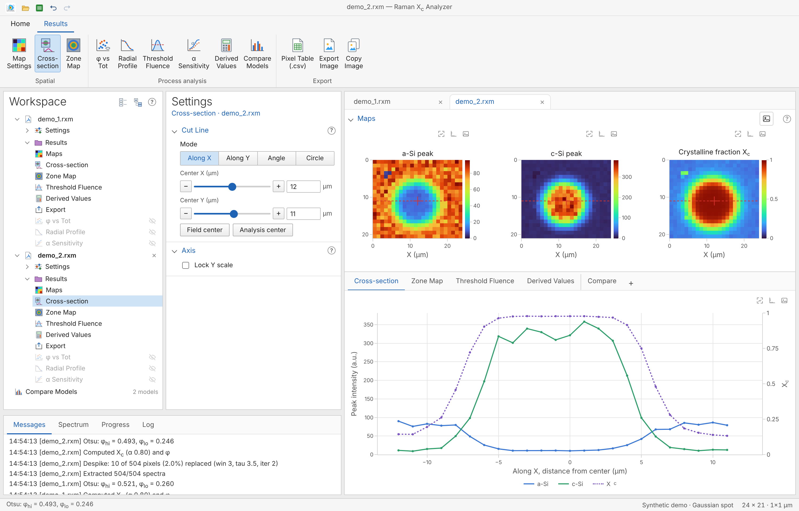
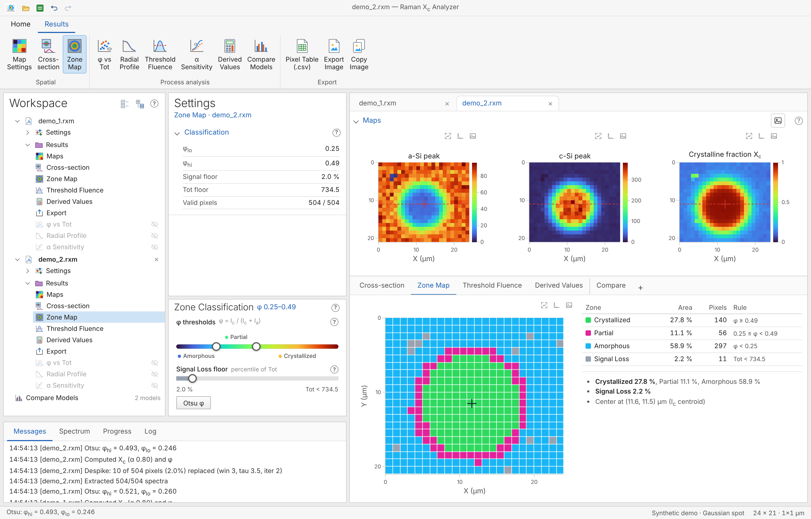
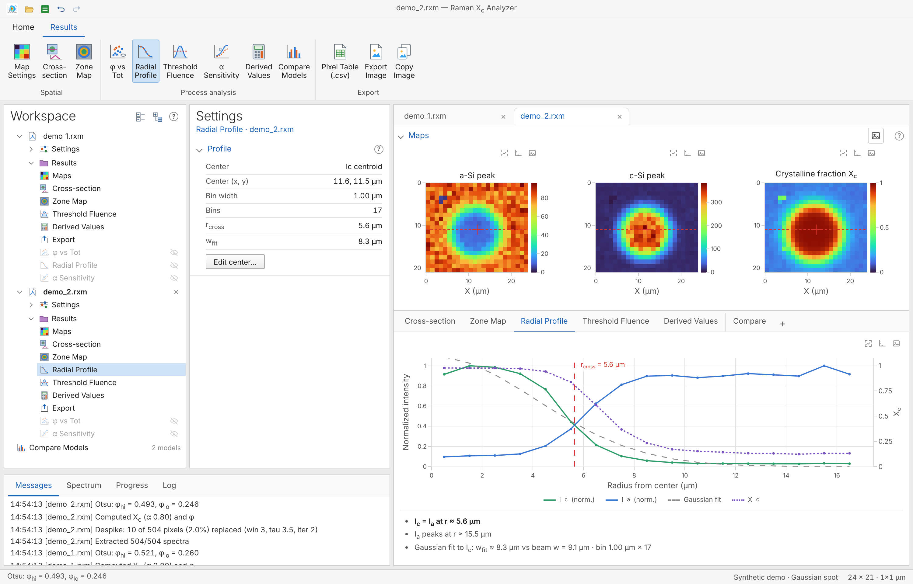
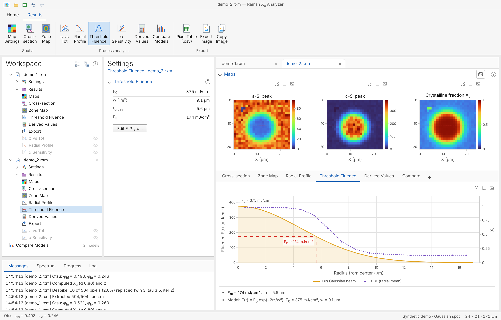

<p align="center">
  
</p>

<h1 align="center">Raman Xc Analyzer</h1>
<p align="center"><i>Crystalline-fraction maps from a grid of Raman spectra.</i></p>

Raman Xc Analyzer reads a folder of two-column Raman spectra measured on a regular grid. For each point it measures the amorphous (a-Si) and crystalline (c-Si) silicon bands and calculates the crystalline fraction Xc. Then it classifies zones, draws cross-sections and a radial profile, and estimates the threshold fluence from a Gaussian beam.

It runs as a macOS app, a Windows app or a single `index.html` in the browser. All three use the same code. No account, no server, and spectra never leave your computer.



## Background

Laser annealing turns amorphous silicon into crystalline silicon. A Raman spectrum shows both phases: a broad a-Si band near 480 cm⁻¹ and a sharp c-Si peak near 520 cm⁻¹. Mapping a laser spot means measuring one spectrum per grid point, often several hundred, and every spectrum needs the same steps: subtract the offset, take the band areas, remove spikes, and convert the two areas to Xc.

Raman Xc Analyzer was built to **do these steps in one place and keep every setting visible**, so that maps from different conditions are made the same way.

## Features

- **Models**: Each dataset is a model with its own settings and results. Open several and compare them.
- **Band extraction**: Peak maximum and trapezoid area for the a-Si and c-Si windows, after an offset r₀ is subtracted.
- **Despike**: Median/MAD filter for cosmic-ray pixels, plus a Pick window to remove spikes by hand.
- **Xc and φ maps**: Xc = Ic / (Ic + α·Ia) with α set directly or solved from a known mean Xc. φ = Ic / (Ic + Ia) needs no α.
- **Zone classification**: Crystallized, Partial, Amorphous and Signal Loss from two φ thresholds and a signal floor. An Otsu button sets the thresholds.
- **Cross-section**: Cut line along X, along Y, at an angle, or a circle around a centre.
- **Radial profile**: Ic, Ia and Xc against radius, with the crossing radius.
- **Threshold fluence**: Fth from the crossing radius, the peak fluence F₀ and the beam radius w.
- **Diagnostics**: α sensitivity, φ vs total signal with Spearman ρ, and derived values (zone shares, In-spec %, CV, Cpk) against an Xc limit.
- **Compare Models**: Xc maps, Xc lines, CDFs and zone shares of all open models.
- **Spectrum view**: Click a pixel on a map or on the Grid preview to see its spectrum and bands.
- **Export Image**: Preview, size (1× to 4×), text size (1× to 3×), and switches for ticks, axis titles, color bar and title. One map or all three maps in one image. Copy to the clipboard with Ctrl/⌘+Shift+C.
- **Tables**: Pixel table as CSV.
- **Help**: `?` buttons open short explanations with diagrams, in English or Korean.
- **Inputs**: Text spectra (`.txt`, `.csv`, `.dat`).

| Cross-section | Zone map |
|---|---|
|  |  |
| **Radial profile** | **Threshold fluence** |
|  |  |

## Install

### macOS

1. Get the latest `RamanXcAnalyzer-x.y.z-macOS.zip` from [Releases](../../releases) and unzip it.
2. Move `Raman Xc Analyzer.app` to `/Applications`.
3. The app is not notarized, so macOS blocks the first launch. Open **System Settings → Privacy & Security** and click **Open Anyway**, or run:
   ```bash
   xattr -dr com.apple.quarantine "/Applications/Raman Xc Analyzer.app"
   ```
4. Open spectra with **Load spectra…** in the Settings panel.

### Windows

1. Get the latest `RamanXcAnalyzer-x.y.z-Windows.zip` from [Releases](../../releases) and unzip it anywhere.
2. Run `RamanXcAnalyzer.exe`. The app is not signed, so SmartScreen may warn: click **More info → Run anyway**.
3. Open spectra with **Load spectra…** in the Settings panel.

It uses the Microsoft Edge WebView2 Runtime, which comes with Windows 11 and current Windows 10. If it is missing, the app shows a link to install it.

### Browser

Open `index.html` in Chrome, Edge, Firefox or Safari. It works offline and can be hosted on GitHub Pages. Keep the `vendor` folder next to it.

### Build from source

macOS needs only the Xcode Command Line Tools (no Xcode).

```bash
xcode-select --install        # skip if already installed
git clone https://github.com/HongHyun-kr/Raman-Xc-Analyzer.git
cd Raman-Xc-Analyzer
bash build.sh                 # → build/Raman Xc Analyzer.app
open "build/Raman Xc Analyzer.app"
```

With only the Command Line Tools, the app is built for your Mac's own chip. The Release zips are universal (Apple Silicon and Intel).

`bash build.sh --zip` also creates `dist/RamanXcAnalyzer-<version>-macOS.zip` for a release.

Windows is built by GitHub Actions, so no Windows PC is needed. To build it on Windows yourself, install the .NET SDK and run `dotnet build win/RamanXcAnalyzer.csproj -c Release -o out/RamanXcAnalyzer`.

## Usage

1. **Load spectra** (all files of one map) or click **Demo Sample**. Each dataset appears as a model in the Workspace.
2. **Grid**: set the number of points in X and Y and the pitch in µm. The Grid preview shows which file lands in which pixel. Click a pixel to see its spectrum.
3. **Offset and Bands**: check that the windows cover the a-Si and c-Si peaks in the Spectrum view.
4. **Despike**, then set **α**, or use **Solve & apply α** if you know the mean Xc from another method.
5. **Process** to get zones, profiles, Fth and derived values. Open them from the **Results** tab.
6. Export the pixel table as CSV, save the plots as PNG, or copy them to the clipboard.

Files are placed on the grid in raster order. The file number is the last number in the file name, and file 1 is at the bottom right. The highest number must equal points in X × points in Y.

**Demo Sample** opens synthetic spectra with a known pattern, so you can try every step without data.

| Key | Action | Key | Action |
|---|---|---|---|
| `⌘Z` / `Ctrl+Z` | Undo | `⌘⇧Z` / `Ctrl+Y` | Redo |
| `⌘⇧C` / `Ctrl+Shift+C` | Copy plot as PNG | `Esc` | Close dialog or popup |

## Requirements

- macOS 11 Big Sur or later (Apple Silicon and Intel)
- Windows 10 or 11, 64-bit
- Any current Chrome, Edge, Firefox or Safari for `index.html`

## Data

| | Location |
|---|---|
| Spectra and results | Only where you save them. Nothing is uploaded |
| macOS settings | `~/Library/WebKit/com.honghyun.ramanxcanalyzer` |
| Windows settings | `%LOCALAPPDATA%\RamanXcAnalyzer` |

Settings are only view preferences such as the help language and the export options. Delete the folder to start fresh.

Input files have two columns, Raman shift (cm⁻¹) and intensity. Spaces, tabs, commas or semicolons can separate them, and a decimal comma is accepted. A descending axis is reversed. Files with fewer than 5 valid rows are skipped.

The CSV export has one row per pixel: `file, x_um, y_um, Ia_area, Ic_area, Xc, phi, Tot, zone`.

## Validation

The calculation chain was checked on synthetic data only: the pipeline against an independent NumPy implementation, and Fth against the value set in the synthetic data. It has not been validated on a real sample set.

## Limitations

- Absolute Xc depends on α, on r₀ and on the band windows. Compare maps only with the same α and windows. Treat absolute Xc as relative until α is calibrated.
- Zones use φ, so they do not depend on α. The Signal Loss floor always flags a fixed share of pixels (2 % by default), even if no signal was lost.
- Fth assumes a round, single-mode Gaussian spot and a measured F₀ and w. The radial profile blurs if the centre is wrong.
- Two adjacent spikes are not removed automatically. Use the Pick window.
- Derived values describe how uniform one map is, with pixels as repeats. They are not a process yield.

## Project layout

```
index.html          the whole tool (HTML, CSS and JavaScript in one file)
vendor/             plotly.min.js, Plotly 2.27.0 (MIT), so the tool works offline
mac/                main.swift (WKWebView shell, save panel, clipboard), Info.plist, icon_1024.png
win/                Program.cs (WebView2 shell, save dialog, clipboard), RamanXcAnalyzer.csproj, icon.ico
tools/              make_ico.py (mac icon → win/icon.ico)
build.sh            builds the macOS app, makes the .icns and signs it; --zip makes the release zip
.github/workflows/  release.yml builds both apps on a version tag and publishes the Release
docs/               screenshots for this README (synthetic data)
```

After editing `index.html`, run `bash build.sh` to rebuild the macOS app.

## How it works

- **One page, three shells**: the whole tool is `index.html`. The macOS app wraps it in `WKWebView` and the Windows app in WebView2. Saving and clipboard copy go through the native shell.
- **Band extraction**: r₀ is subtracted. For the a-Si and c-Si windows, the tool takes the maximum and the trapezoid area (Ia, Ic) for each pixel.
- **Despike**: A pixel is replaced by its local median when it is far from the median (τ · 1.4826 · MAD) and above all its neighbours [1]. It runs on the band maxima and areas.
- **Xc and φ**: Xc = Ic / (Ic + α·Ia) and φ = Ic / (Ic + Ia).
- **Zones**: Signal Loss first (Tot = Ic + Ia at or below zero, or below the floor percentile). Then φ ≥ φ_hi is Crystallized, φ ≥ φ_lo is Partial, and the rest is Amorphous. The Otsu button splits the φ histogram into two groups to set φ_hi [2], and sets φ_lo to half of it.
- **Radial profile and Fth**: Ic and Ia are averaged in rings around the centre and each is scaled to its maximum. r_cross is the first radius where scaled Ic falls below scaled Ia. Fth = F₀ · exp(−2 r_cross² / w²) [3].
- **α solver**: A bisection on α finds the value that gives the mean Xc you enter.

| Parameter | Default | Meaning |
|---|---|---|
| Offset r₀ | 260 | Subtracted from every spectrum before the bands are read |
| a-Si window | 480–490 cm⁻¹ | Band for Ia |
| c-Si window | 510–530 cm⁻¹ | Band for Ic |
| Despike window / τ / passes | 3 / 3.5 / 2 | Median window, MAD threshold, repeats |
| α | 0.8 | Raman efficiency ratio in Xc |
| φ thresholds | 0.15 / 0.50 | Amorphous / Partial / Crystallized borders (Otsu changes them) |
| Signal Loss floor | 2 % | Share of lowest-signal pixels flagged |
| Grid | 25 × 25, 2 µm | Points in X and Y, pitch |
| Beam radius w / F₀ | 25 µm / 390 mJ/cm² | Inputs for Fth |

## Releasing

Push a version tag. GitHub Actions builds the macOS and Windows apps and publishes one Release with both zips and `RELEASE_NOTES.md` as its text.

```bash
git tag v1.0.0
git push origin v1.0.0
```

To make the macOS zip by hand, run `bash build.sh --zip` and attach `dist/RamanXcAnalyzer-x.y.z-macOS.zip`. Always upload the zip, not the `.app` itself, so the app keeps its executable permission.

## References

1. C. Leys et al., "Detecting outliers: Do not use standard deviation around the mean, use absolute deviation around the median," *J. Exp. Soc. Psychol.* **49**, 764–766 (2013).
2. N. Otsu, "A threshold selection method from gray-level histograms," *IEEE Trans. Syst. Man Cybern.* **9**, 62–66 (1979).
3. J. M. Liu, "Simple technique for measurements of pulsed Gaussian-beam spot sizes," *Opt. Lett.* **7**, 196–198 (1982).

## License

[MIT](LICENSE) © 2026 [HongHyun-kr](https://github.com/HongHyun-kr)
